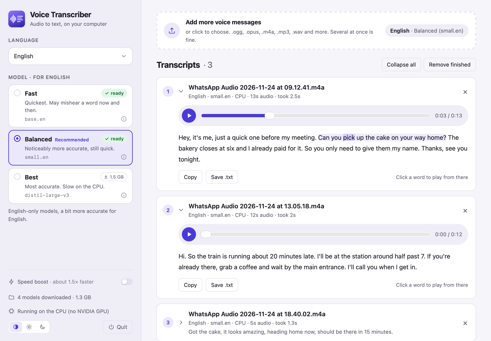

# Voice Transcriber

**Offline speech-to-text for any audio.** A small app that turns voice messages, recordings, meetings, interviews, lectures, podcasts and other audio or video files into text, using OpenAI's Whisper speech recognition model (through faster-whisper). It understands about 100 languages, like English, Turkish, German or Spanish. You drag a file into the app and get the text back, with the words highlighted as you play it.

Everything runs on your own computer, on Windows, macOS or Linux. Your audio is never uploaded anywhere. The internet is only used once, to download a model the first time you use it.

It's handy whenever you'd rather read than listen: a long voice message from a friend, notes from a meeting, or a quote you need from an interview.


## What it does

- Drag one or more audio or video files onto the page (.ogg, .opus, .m4a, .mp3, .wav, .mp4 and more).
- Pick the language, or let the app detect it.
- Pick one of three models: fast, balanced or best. Turn on speed boost for quicker results.
- Run on your graphics card (GPU) or on the processor (CPU).
- See every transcript in a numbered list. You can collapse items, remove them, copy the text or save it as a .txt file.
- Play the audio right inside the list. The text follows along as it plays.
- Each result shows how long it took, so you can compare models and GPU vs CPU.

<picture>
  <source media="(prefers-color-scheme: dark)" srcset="docs/screenshot-dark.png">
  
</picture>

## Listening along

Every transcript has its own small player. Press play and the app highlights the sentence you are hearing, and the word inside it a bit stronger. If the text is long, the page scrolls with it.

- Click any word to jump to that spot in the audio.
- Drag the slider to move around.
- Press `Space` to play or pause the last recording you used.
- Only one recording plays at a time. Starting another one pauses the first.

This works because the model also tells us when each word starts and ends. The timing is usually very close, but it can be a little off on fast or unclear speech.

## Download

Ready-made apps, nothing else to install:

- **Windows** (64-bit): `Voice-Transcriber-<version>-windows-x64-setup.exe`. Run it to install. No administrator rights needed.
- **macOS** (Apple Silicon): `Voice-Transcriber-<version>-mac-arm64.dmg`. Open it and drag **Voice Transcriber** to Applications.
- **Linux**: there is no ready-made app yet. [Run it from the source code](#run-from-the-source-code), which takes one command.

Get them from the [Releases](https://github.com/ozardali/voice-transcriber/releases) page.

The apps aren't signed with a paid Apple or Microsoft certificate yet, so the first start shows a warning:

- **macOS:** "Apple could not verify…". Click **Done**, then open **System Settings → Privacy & Security**, scroll down and click **Open Anyway** next to Voice Transcriber.
- **Windows:** "Windows protected your PC". Click **More info**, then **Run anyway**.

In the apps, models download to `%LOCALAPPDATA%\Voice Transcriber` (Windows) or `~/Library/Application Support/Voice Transcriber` (macOS). The log files `app.log` and `crash.log` are there too. The Windows uninstaller removes that folder. The Windows app runs on the CPU; for an NVIDIA GPU, run it from the source code on Linux.

If the Windows app stops unexpectedly, it shows a message with the error and the end of its log. Press `Ctrl+C` in that message to copy the text, and paste it into an [issue](https://github.com/ozardali/voice-transcriber/issues). If its window can't open, the app opens in your browser instead.

## Run from the source code

### What you need

- Linux (tested on CachyOS with KDE) or macOS. On a Mac it always runs on the CPU. On Windows, use the [installer](#download).
- Python 3.10 or newer
- Optional: an NVIDIA graphics card. Without one, it still works on the CPU, just slower.

You don't have to install Python yourself. If it's missing, `./start.sh` tells you what it will install and asks first. It uses Homebrew on macOS (and offers to install Homebrew too), and pacman, apt, dnf or zypper on Linux.

### Getting started

```bash
git clone https://github.com/ozardali/voice-transcriber.git
cd voice-transcriber
./start.sh
```

The first start takes a few minutes. It creates a `.venv` folder and installs everything there. If it finds an NVIDIA card, it also installs the CUDA libraries (about 2 GB). It also asks if you want a **Voice Transcriber** icon in your apps and on your desktop. After that, the app opens in its own window. Close the window to stop it.

Later, just run `./start.sh` again, or click the icon.

If the window can't open (for example, a library is missing on Linux), the app opens in your browser at http://127.0.0.1:7860 instead. Then press `Ctrl+C` in the terminal to stop it.

### The app icon

If you said yes, `./start.sh` added a **Voice Transcriber** icon to your app menu and your desktop. On macOS it creates `Voice Transcriber.app` in your Applications folder (or in `~/Applications` if you can't write there). Click it and the app opens in its own window, with its own icon in the Dock or taskbar. If it's already running, the icon brings the window to the front.

If Python is still missing, the icon opens a terminal instead and runs `./start.sh` there, so it can ask before installing anything.

To stop it, close the window (or press `Cmd+Q` on a Mac). The app writes its log to `app.log`.

If you move the folder, run `./start.sh` once and it updates the icon. If you said no and want the icon after all, delete `.venv/.no-shortcut` and run `./start.sh`.

## Languages and models

Choose the language first. The model list then shows the right models for it. If you pick **Detect automatically**, the app guesses the language from the first 30 seconds and shows what it found next to the result.

English has its own models, which are a bit more accurate for English:

| Option | Model | Download size | Good for |
|---|---|---|---|
| Fast | `base.en` | about 140 MB | Quick checks. Sometimes it gets a word wrong. |
| Balanced | `small.en` | about 480 MB | Much better, still quick. |
| Best | `distil-large-v3` | about 1.5 GB | The most accurate. Slow on the CPU. |

Every other language uses the multilingual models:

| Option | Model | Download size | Good for |
|---|---|---|---|
| Fast | `base` | about 145 MB | A rough idea. Makes mistakes in most languages. |
| Balanced | `small` | about 485 MB | Good for common languages like Spanish, German or Turkish. |
| Best | `large-v3-turbo` | about 1.6 GB | The most accurate, in many languages. A bit slower on the CPU. |

How well a language works depends on how much of it the model heard during training. Big languages work well, rare ones less so. If the result looks wrong, try **Best**.

A model downloads the first time you use it. The page shows "ready" next to the models you already have. They are saved in the `models` folder inside the app folder, so deleting the app folder removes them too. At the bottom of the sidebar you can see how much space they take, and click to open the folder.

## GPU or CPU?

Use the **Run on** switch to choose. Here is how long a 1 minute 53 second English voice message took on my computer (RTX 3060 Ti and a 12 thread CPU):

| Model | GPU | CPU |
|---|---|---|
| Fast | 0.9 s | 3.6 s |
| Balanced | 1.5 s | 10.4 s |
| Best | 1.6 s | 18.9 s |

With a GPU, all three are about the same speed, so just use **Best**. On the CPU, **Balanced** is a good middle ground.

### Speed boost

Turn on **Speed boost** at the bottom of the sidebar if you want results sooner. Normally the model compares five possible next words at each step (beam size 5). Speed boost keeps only the most likely one (beam size 1). In tests on an M1 Mac this was about 1.5 times faster on the CPU, with almost the same accuracy. The setting is remembered, and each result shows if it was made with speed boost on.

If you pick GPU but it doesn't work, the app uses the CPU instead and tells you in the result.

### Adding GPU support later

If you installed the app before you had an NVIDIA card (or the GPU option is greyed out), run:

```bash
.venv/bin/pip install -r requirements-gpu.txt
```

The CUDA libraries go into `.venv` only. You don't need to install CUDA on your system, just the normal NVIDIA driver.

## Files

| File | What it is |
|---|---|
| `app.py` | The server. It decodes the audio and runs the model. |
| `models/` | Downloaded models. Created on first use, not part of git. |
| `static/index.html` | The page itself (plain HTML). |
| `static/style.css` | How it looks, with the light and dark colors at the top. |
| `static/app.js` | What it does: language picker, queue, player and word highlighting. |
| `start.sh` | The only script you run. It installs what's missing, adds the icon and starts the app. The icon runs it as `start.sh --launch`. |
| `assets/` | The app icon. `AppIcon.icon` is the layered macOS version (light, dark, tinted and clear), `icon.ico` is for Windows, `icon.svg` is for Linux. After changing the design, run `assets/build-icons.sh` (macOS with Xcode) to rebuild `Assets.car` and `icon.icns`. |
| `requirements.txt` | Python packages. |
| `requirements-gpu.txt` | Extra packages for NVIDIA GPUs. |
| `docs/` | The screenshots and the animation in this README. |
| `packaging/` | Builds the macOS and Windows apps (see below). |
| `.github/workflows/build.yml` | Builds both apps on GitHub. |
| `LICENSE` | MIT license. |

## Settings

You can change these when you start the app:

```bash
PORT=8000 ./start.sh        # use another port
NO_WINDOW=1 ./start.sh      # use the browser instead of an app window
NO_BROWSER=1 ./start.sh     # only run the server, open nothing
```

## Good to know

- The app only listens on `127.0.0.1`, so other devices on your network can't use it.
- It transcribes one file at a time. If you drop several, they wait in a queue.
- Audio is decoded with [PyAV](https://pyav.org), which brings its own copy of FFmpeg, so you don't need to install ffmpeg. (The decoder that comes with faster-whisper didn't work with the newest PyAV version, so the app has its own small one.)

## Building the apps

On GitHub: open **Actions → Build apps → Run workflow** and pick Windows, Mac or both. The files appear at the bottom of the run, under Artifacts. Pushing a tag like `v1.0.0` builds both and puts them on a new release.

On your own computer, with Python 3.12:

```bash
packaging/build-mac.sh                                            # Apple Silicon Mac
powershell -ExecutionPolicy Bypass -File packaging\build-windows.ps1  # Windows, needs Inno Setup 6
```

The version number is set in `packaging/voice-transcriber.spec`.

## Built with

- [faster-whisper](https://github.com/SYSTRAN/faster-whisper) for speech to text
- [Flask](https://flask.palletsprojects.com/) for the small web server
- [pywebview](https://pywebview.flowrl.com/) for the app window
- [PyInstaller](https://pyinstaller.org/) and [Inno Setup](https://jrsoftware.org/isinfo.php) for the downloadable apps

## License

MIT. See [LICENSE](LICENSE).
